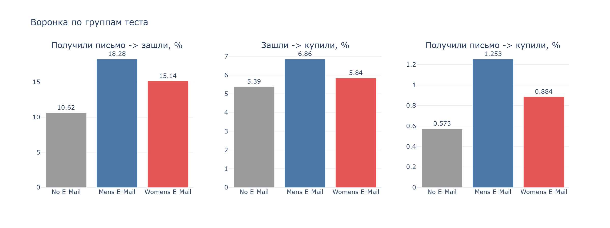
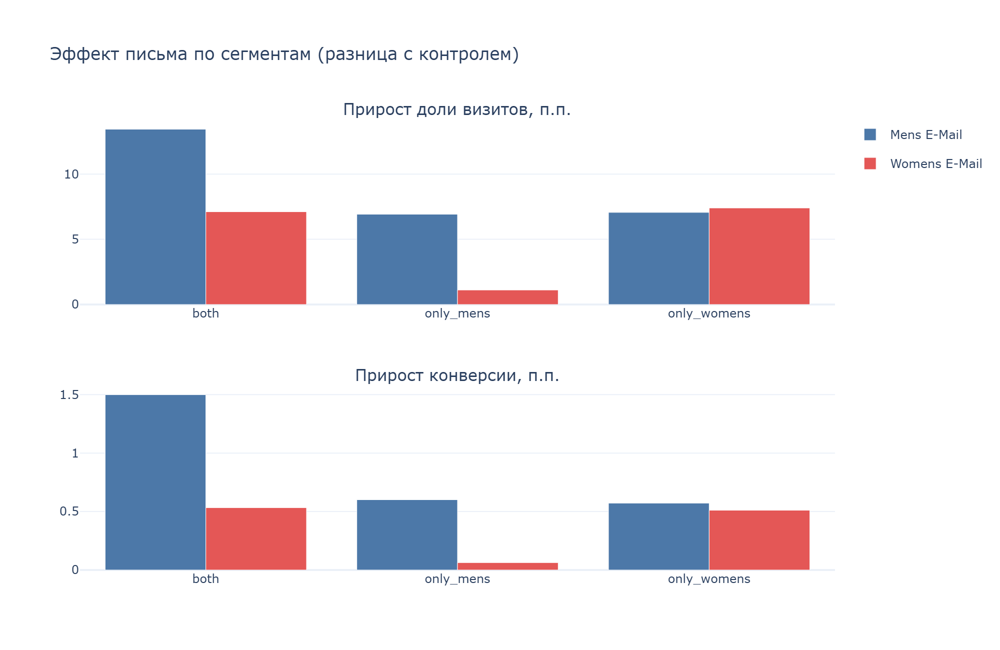
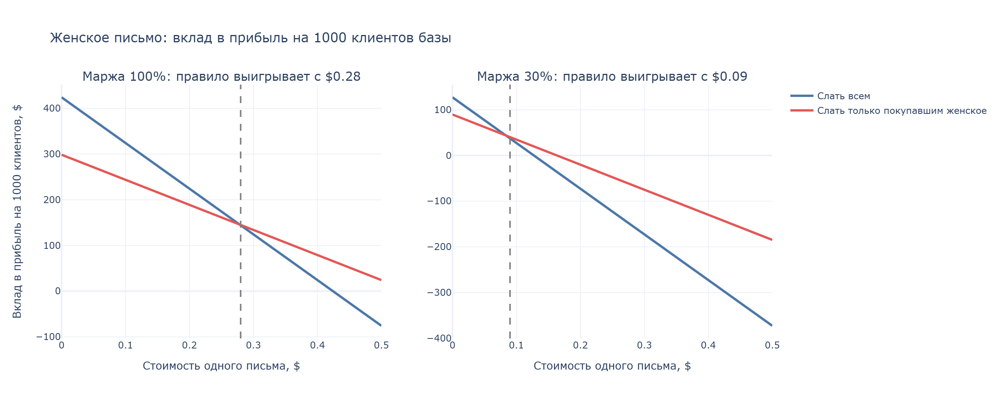
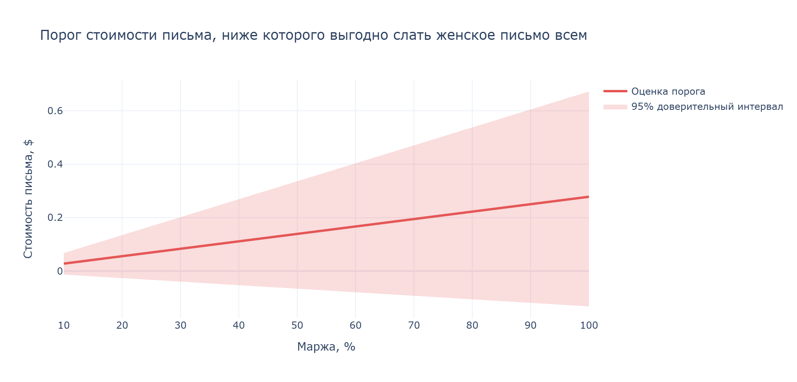

# A/B-тест email-рассылки: анализ, uplift-модель и дашборд

Магазин разослал клиентам письма двух видов (с мужской и с женской подборкой) и оставил контрольную группу без письма. В проекте на реальных данных этого теста разобрано, **работает ли рассылка, кому она помогает и когда её выгодно отправлять не всем**.

Проект проходит весь путь продуктового аналитика: проверка дизайна теста, статистика, сегментный анализ, базовый ML (uplift), SQL-запросы и дашборд.

## Данные

[Hillstrom Email Marketing](https://www.kaggle.com/datasets/sumittarya/hillstrom-email-marketing): 64 000 клиентов, три равные группы (письмо с мужской подборкой, с женской подборкой, без письма). Для каждого клиента известны давность и сумма прошлых покупок, что покупал, новичок ли, тип района и канал. Результаты за две недели: заходил ли на сайт, купил ли, сколько потратил.

Сами данные в репозиторий не включены, их нужно скачать с Kaggle.

## Главные результаты

| Вопрос | Ответ |
|---|---|
| Деление на группы честное? | Да: нарушения пропорций (SRM) нет, все признаки сбалансированы |
| Письма работают? | Да, оба. Конверсия: 0,57% без письма, 0,88% с женским (+54%), 1,25% с мужским (в 2,2 раза). Значимо даже с поправкой на множественные сравнения |
| Какое письмо лучше? | Мужское: выше и конверсия, и визиты, и траты |
| Всем ли письмо помогает одинаково? | Мужское почти да. Женское сильно зависит от клиента: покупавшим женское оно даёт +7,4 п.п. к доле визитов, покупавшим только мужское +1,1 п.п. |
| Нужна ли сложная модель? | Нет. Uplift-модель хорошо ранжирует клиентов по визитам, но находит по сути один фактор, и простое правило по нему не хуже |
| Когда стоит слать не всем? | Пока письмо заметно дешевле дополнительной выручки на клиента, выгоднее слать всем. Порог зависит от маржи: около $0,28 при марже 100% и около $0,08 при марже 30%. Данные определяют его неточно (доверительный интервал включает ноль) |

**Рекомендация.** Если письмо одно, слать мужское. Женское слать всем, пока отправка дешёвая относительно маржи с продаж. Если стоимость письма сопоставима с дополнительной выручкой на клиента или нужно ограничить объём рассылки, слать женское только покупавшим женские товары. Точный порог по данным определить нельзя, потому что в них нет маржи, а оценка дополнительных трат шумная.

## Что сделано

1. **A/B-анализ** ([notebooks/01_ab_test_analysis.ipynb](notebooks/01_ab_test_analysis.ipynb)): проверка качества данных, гипотезы и метрики, SRM, баланс групп, расчёт мощности и минимального обнаруживаемого эффекта, z-тест для долей, t-тест Уэлча и бутстрап для трат, доверительные интервалы, поправка Бонферрони.
2. **Сегментный анализ** ([notebooks/02_segment_analysis.ipynb](notebooks/02_segment_analysis.ipynb)): эффект каждого письма в 22 сегментах, поправка Бенджамини-Хохберга (FDR), формальная проверка, что эффект зависит от сегмента (логистическая регрессия с взаимодействием).
3. **Uplift-модель** ([notebooks/03_uplift_model.ipynb](notebooks/03_uplift_model.ipynb)): T-learner, преобразование классов, оценка по кросс-валидации, Qini-кривые с бутстрап-интервалами, uplift по децилям, честная оценка дополнительной выручки за вычетом стоимости письма и сравнение с простым правилом.
4. **SQL, экономика и дашборд** ([notebooks/04_sql_and_dashboard.ipynb](notebooks/04_sql_and_dashboard.ipynb), [sql/](sql/)): те же результаты на SQL, запросы пригодны для Redash (параметры стоимости письма и маржи), порог стоимости письма с бутстрап-интервалом при разной марже, интерактивный дашборд на Plotly.

## Дашборд









## Ограничения

- Данные охватывают две недели, поэтому долгосрочный эффект и усталость от писем не видны.
- Покупают меньше 1% клиентов, поэтому оценки трат шумные, а выводы по визитам надёжнее, чем по деньгам.
- В данных нет дат, поэтому нет анализа динамики по дням.
- Стоимость письма и маржа в данных не указаны: мы перебираем разные значения. Траты в данных это выручка, поэтому экономические оценки считаются как дополнительная выручка за вычетом стоимости письма при заданной марже.
- Порог стоимости письма оценён неточно: 95%-й интервал дополнительных трат нужной группы включает ноль.

## Стек

Python (pandas, NumPy, SciPy, statsmodels, scikit-learn), SQL (SQLite), Plotly, Jupyter. Ноутбуки запускались на Kaggle.

## Структура репозитория

```
notebooks/   анализ по частям (1–4)
sql/         SQL-запросы для дашборда
images/      скриншоты дашборда
```

## Как повторить

1. Откройте ноутбук на Kaggle (File → Import Notebook).
2. Подключите датасет [Hillstrom Email Marketing](https://www.kaggle.com/datasets/sumittarya/hillstrom-email-marketing) через Add Data.
3. Запустите все ячейки (Run All). Ноутбуки независимы и запускаются в любом порядке.
