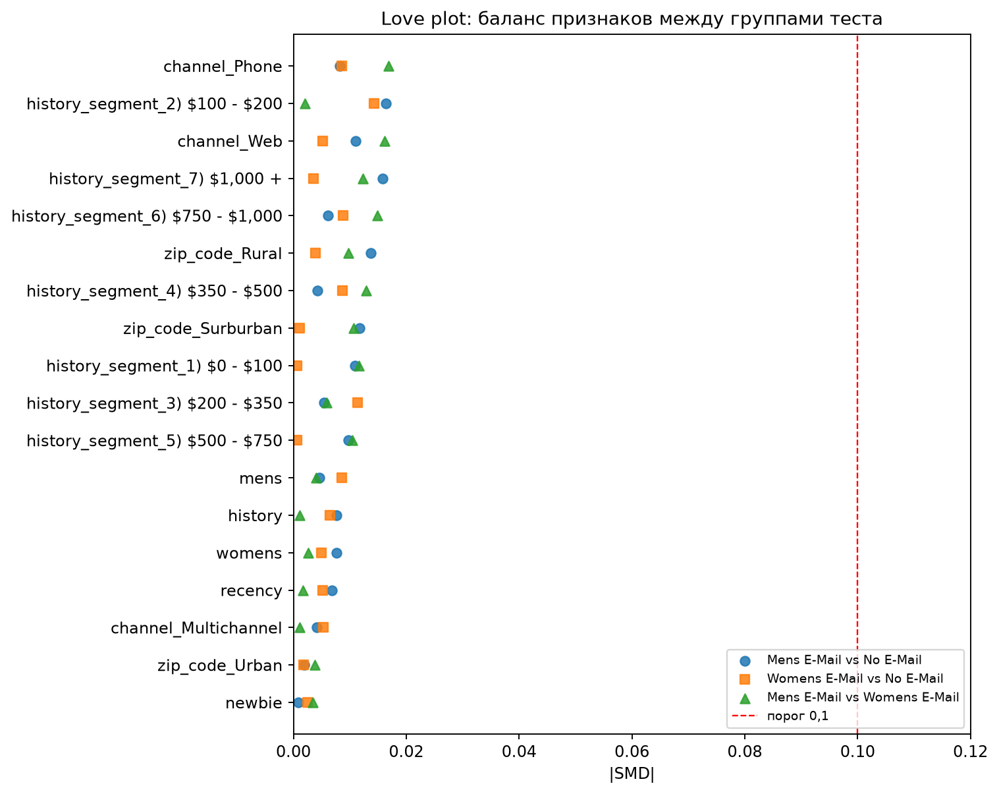

# A/B-тест email-рассылки: анализ, uplift-модель и дашборд

Магазин разослал клиентам письма двух видов (с мужской и с женской подборкой) и оставил контрольную группу без письма. В проекте на реальных данных этого теста разобрано, **работает ли рассылка, кому она помогает и когда её выгодно отправлять не всем**.

Проект проходит весь путь продуктового аналитика: проверка дизайна теста, статистика, сегментный анализ, базовый ML (uplift), SQL-запросы, дашборд и проверка надёжности выводов.

## Данные

[Hillstrom Email Marketing](https://www.kaggle.com/datasets/sumittarya/hillstrom-email-marketing): 64 000 клиентов, три равные группы (письмо с мужской подборкой, с женской подборкой, без письма). Для каждого клиента известны давность и сумма прошлых покупок, что покупал, новичок ли, тип района и канал. Результаты за две недели: заходил ли на сайт, купил ли, сколько потратил.

Сами данные в репозиторий не включены, их нужно скачать с Kaggle.

## Главные результаты

| Вопрос | Ответ |
|---|---|
| Деление на группы честное? | Да: нарушения пропорций (SRM) нет, все признаки сбалансированы (стандартизированная разность средних не больше 0,017 по модулю при пороге 0,1) |
| Письма работают? | Да, оба. Конверсия: 0,57% без письма, 0,88% с женским (+54%), 1,25% с мужским (в 2,2 раза). Значимо даже с поправкой на множественные сравнения |
| Какое письмо лучше? | Мужское. Конверсия выше на 0,37 п.п. и визиты выше на 3,1 п.п. (значимо с поправкой Холма). По тратам разница лишь пограничная: +$0,35 на клиента [0,02; 0,67], p по Холму 0,031. Интервалы прямых сравнений без поправки на множественные сравнения |
| Всем ли письмо помогает одинаково? | Мужское почти да. Женское сильнее приводит на сайт покупавших женское (+7,4 п.п. к доле визитов против +1,1 п.п. у покупавших только мужское) и новичков. По покупкам и тратам различия между сегментами слабее и формально не подтверждены, а в части сегментов слишком мало покупок (меньше 20 в одной из групп) для надёжных оценок |
| Нужна ли сложная модель? | Нет. Uplift-модель ранжирует клиентов по визитам лучше случайного порядка (подтверждено на отложенной выборке), но находит по сути один фактор. Простое правило по нему не хуже, а разница между правилом и моделями меньше разброса между разбиениями |
| Когда стоит слать не всем? | Пока письмо заметно дешевле дополнительной выручки на клиента, выгоднее слать всем: при цене письма до $0,20 ни одна модель не выигрывала у рассылки всем в большинстве из 10 отложенных разбиений (доля выигрышей не выше 30%), а простое правило выигрывало лишь в 50–60% разбиений. Эти разбиения пересекаются, поэтому служат проверкой чувствительности, а не независимыми экспериментами. Ни у одной из 25 проверенных стратегий (с учётом стоимости письма) преимущество над рассылкой всем не подтверждено: доверительные интервалы включают ноль. Порог зависит от маржи (около $0,28 при марже 100% и около $0,08 при марже 30%) и определён неточно: доверительный интервал включает ноль |

**Рекомендация.** Если письмо одно, слать мужское. Женское слать всем, пока отправка дешёвая относительно маржи с продаж. Если стоимость письма сопоставима с дополнительной выручкой на клиента или нужно ограничить объём рассылки, слать женское только покупавшим женские товары как гипотезу, которую нужно проверить новым A/B-тестом: выигрыш этого правила по данным не доказан (интервал включает ноль). Точный порог по данным определить нельзя: в них нет маржи, а оценка дополнительных трат шумная. Выводы по визитам и общему эффекту писем устойчивы, выводы о таргетинге по деньгам предварительные.

## Что сделано

1. **A/B-анализ** ([notebooks/01_ab_test_analysis.ipynb](notebooks/01_ab_test_analysis.ipynb)): проверка качества данных, гипотезы и метрики, SRM, баланс групп, расчёт мощности и минимального обнаруживаемого эффекта, z-тест для долей, t-тест Уэлча и бутстрап для трат, доверительные интервалы, поправка Бонферрони.
2. **Сегментный анализ** ([notebooks/02_segment_analysis.ipynb](notebooks/02_segment_analysis.ipynb)): эффект каждого письма в 22 сегментах, поправка Бенджамини-Хохберга (FDR), формальная проверка, что эффект зависит от сегмента (логистическая регрессия с взаимодействием).
3. **Uplift-модель** ([notebooks/03_uplift_model.ipynb](notebooks/03_uplift_model.ipynb)): T-learner, преобразование классов, оценка по кросс-валидации, Qini-кривые с бутстрап-интервалами (2000 повторов), uplift по децилям, оценка дополнительной выручки за вычетом стоимости письма и сравнение с простым правилом.
4. **SQL, экономика и дашборд** ([notebooks/04_sql_and_dashboard.ipynb](notebooks/04_sql_and_dashboard.ipynb), [sql/](sql/)): те же результаты на SQL, запросы пригодны для Redash (параметры стоимости письма и маржи), порог стоимости письма с бутстрап-интервалом при разной марже, интерактивный дашборд на Plotly.
5. **Проверки надёжности** ([notebooks/05_robustness_checks.ipynb](notebooks/05_robustness_checks.ipynb)): прямое сравнение мужского и женского писем по трём метрикам с поправкой Холма, стандартизированные разности средних (SMD) и Love plot, число покупок в сегментах, доверительные интервалы выигрыша стратегий (вложенная кросс-валидация и IPW), тесты взаимодействия с тратами и двумя способами поправки, прямые сравнения эффектов, устойчивость Qini к разбиению, оценка на отложенной выборке, сверка Python и SQL, сверка чисел README с пересчётом.

## Графики и дашборд




## Допущения

- **Выручка, а не прибыль.** Траты в данных это выручка. Экономические оценки считаются как маржа × дополнительные траты клиента − стоимость письма. Маржа и стоимость письма в данных не указаны, поэтому перебираются.
- **Клиент без письма ведёт себя как контрольная группа.** Горизонт две недели, отписки и долгосрочный эффект не учтены.
- **Сегменты** заданы по признакам, известным до рассылки. Проверок много, поэтому к p-value применена поправка FDR; доверительные интервалы на графиках сегментов без поправки.
- **Правило «покупал женское»** выбрано после просмотра сегментного анализа, то есть не независимо от данных.
- **Отложенная оценка** таргетинга: 30% клиентов отложено, выбор охвата только по остальным 70%, 10 случайных разбиений. Разбиения пересекаются, это не независимые эксперименты: разброс между ними описывает чувствительность к разбиению и недооценивает реальную неопределённость.
- **Доверительные интервалы выигрыша стратегий** получены бутстрапом по клиентам при зафиксированных решениях (вложенная кросс-валидация). Они не учитывают неопределённость выбора модели и охвата, поэтому реальная неопределённость больше.
- **Преобразование классов** предполагает почти равные группы (здесь 50,1% и 49,9%), иначе формула uplift смещается.
- **Интервалы прямых сравнений** писем (часть 5) и A/B-анализа (часть 1) стандартные 95%, без поправки на множественные сравнения; поправка применена к p-value.

## Ограничения

- Данные охватывают две недели, поэтому долгосрочный эффект и усталость от писем не видны.
- Покупают меньше 1% клиентов, поэтому оценки трат шумные, а выводы по визитам надёжнее, чем по деньгам.
- В данных нет дат, поэтому нет анализа динамики по дням.
- Выигрыш любой стратегии таргетинга над рассылкой всем статистически не подтверждён (интервалы включают ноль).
- Порог стоимости письма оценён неточно: 95%-й интервал дополнительных трат нужной группы включает ноль.
- В 12 из 44 пар «сегмент × письмо» меньше 20 покупок в одной из групп (в основном история покупок от $500 и давность 7–12 месяцев), оценки там ненадёжны.
- Эффект по сегментам для покупок и трат слабо подтверждён тестами взаимодействия; уверенно подтверждены различия по визитам.
- Результаты моделей на основе градиентного бустинга зависят от среды запуска (версии библиотек). Логистические модели воспроизводятся точно.

## Воспроизводимость

Ноутбуки запускались на Kaggle со следующими версиями:

| Библиотека | Версия |
|---|---|
| Python | 3.13.15 |
| pandas | 2.3.3 |
| NumPy | 2.1.3 |
| SciPy | 1.16.3 |
| statsmodels | 0.15.0 |
| scikit-learn | 1.6.1 |

SQL выполняется встроенным в Python SQLite. Версия Plotly не фиксировалась. Случайные разбиения и бутстрап используют фиксированные seed. Результаты Python и SQL совпадают, ключевые числа таблицы конверсий и визитов сверяются с пересчётом в ноутбуке 5, остальные числа этого README считаются в нём же.

## Структура репозитория

```
notebooks/   анализ по частям (1–5)
sql/         SQL-запросы для дашборда
images/      графики дашборда
```

## Как повторить

1. Откройте ноутбук на Kaggle (File → Import Notebook).
2. Подключите датасет [Hillstrom Email Marketing](https://www.kaggle.com/datasets/sumittarya/hillstrom-email-marketing) через Add Data.
3. Запустите все ячейки (Run All). Ноутбуки независимы и запускаются в любом порядке. Ноутбук 5 в первой ячейке печатает версии библиотек вашего окружения.
